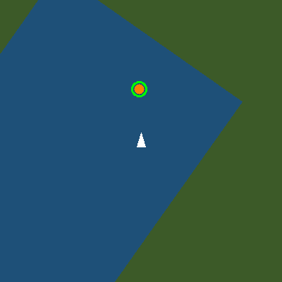
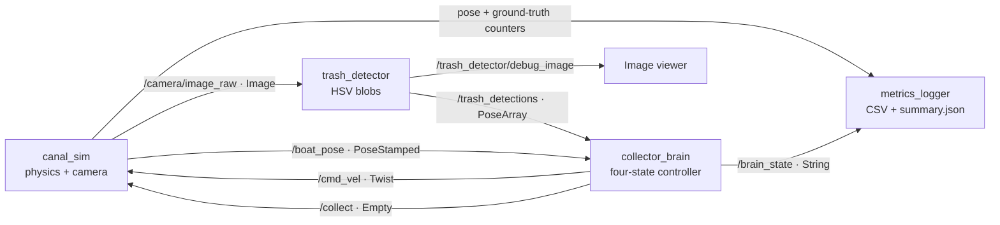
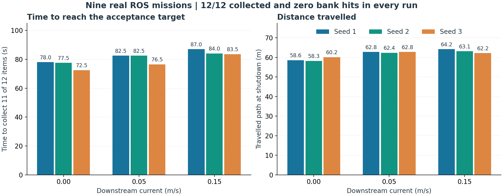

# trash_boat

A simulated boat that sees floating trash, steers towards it, and scoops it up.
Built as a **ROS 2 Jazzy course project** using Python, OpenCV, and standard ROS messages.

[](https://github.com/Abhinav-Siddharth/ROS-TRASH/actions/workflows/ci.yml)

**Measured:** all nine seed/current experiments collected **12/12 items with zero bank
hits**. All items were first recorded collected in **80.5–87.0 seconds**. See the
[results and trajectories](docs/RESULTS.md) and [raw numeric evidence](docs/results/experiments.json).



## Build and run

Use Ubuntu 24.04, ROS 2 Jazzy at `/opt/ros/jazzy`, and system Python 3.12.
The local verification environment is Pop!_OS 24.04 with those Jazzy/system packages.
No Gazebo, learned models, hardware, or virtual environment is required.

Start in the repository root. In a new checkout, `git clone` this repository and
`cd ROS-TRASH` first.

```bash
# Use the distribution libraries expected by cv_bridge.
export PYTHONNOUSERSITE=1
source /opt/ros/jazzy/setup.bash

# Keep this demo separate from unrelated ROS projects on your machine.
export ROS_DOMAIN_ID=73
export ROS_AUTOMATIC_DISCOVERY_RANGE=LOCALHOST

colcon build --symlink-install
source install/setup.bash

# Choose a new output directory for each run to preserve earlier measurements.
ros2 launch trash_boat_bringup mission.launch.py \
  seed:=42 output_dir:="$PWD/log/demo_seed42"
```

Press **Ctrl-C** to stop all nodes cleanly and write `log/demo_seed42/summary.json`.
The CSV is written during the run. The boat keeps patrolling after collecting the
last item; stopping the mission is the operator's job, or the external verifier's.
The controller does not read collection counters.

On a prepared ROS/Jazzy machine with rosdep initialized, install declared dependencies
before building:

```bash
rosdep install --from-paths src --ignore-src -y
```

The manifests declare ROS interfaces, `cv_bridge`, OpenCV, NumPy, launch support,
and test dependencies. `PYTHONNOUSERSITE=1` is important here: a user-installed NumPy 2
was found to crash the installed Jazzy `cv_bridge`. This setting selects the existing
system packages without changing your global Python installation.

For the simulator alone:

```bash
ros2 launch trash_boat_bringup sim.launch.py
```

## Watch the system

In each additional terminal, use the same environment exports and source
`/opt/ros/jazzy/setup.bash` and this workspace's `install/setup.bash`.

```bash
ros2 topic echo /brain_state --field data
ros2 topic echo /trash_collected --field data
ros2 node info /collector_brain
ros2 topic hz /camera/image_raw
```

Run each long-lived command in its own terminal and stop it with Ctrl-C.
If `rqt_image_view` is installed, view `/trash_detector/debug_image`:

```bash
ros2 run rqt_image_view rqt_image_view /trash_detector/debug_image
```

The normal image shows a white boat and orange trash; the debug image circles detected
trash in green. `SEARCH`, `APPROACH`, `COLLECT`, and `AVOID_BANK` describe what the
controller is doing. A camera image initially containing no trash is normal: the boat
must move far enough downstream to see the first item.

## Architecture



| Package | Responsibility | Start reading here |
|---|---|---|
| `trash_boat_sim` | Canal, drifting trash, boat motion, camera, scoop, bank contacts | [canal_sim.py](src/trash_boat_sim/trash_boat_sim/canal_sim.py) |
| `trash_boat_perception` | Detect orange blobs and convert pixels into boat coordinates | [detector_core.py](src/trash_boat_perception/trash_boat_perception/detector_core.py) |
| `trash_boat_control` | Patrol, approach, scoop, avoid banks; separately log metrics | [logic.py](src/trash_boat_control/trash_boat_control/logic.py) |
| `trash_boat_bringup` | Start the nodes and share consistent parameters | [params.yaml](src/trash_boat_bringup/config/params.yaml) |

The image-processing and decision modules contain **no ROS imports**. Their ROS nodes
handle messages, timers, and publishers. This makes the algorithms easy to test and
explain independently of message transport.

**Data boundary:** trash positions come from camera pixels. `/trash_collected`,
`/trash_remaining`, and `/bank_hits` are available only to measurement tools and the
metrics logger, never to the detector or collector brain.

## How it works

1. **Simulate:** a boat starts at `(2, 0)` in a 60 × 8 m canal containing 12 seeded
   trash items. Trash drifts downstream. Physics and pose run at 20 Hz, camera at 10 Hz.
2. **See:** HSV thresholding isolates orange pixels. Morphological opening removes
   tiny noise; contour area and image moments give blob centroids, nearest first.
3. **Locate:** the 400 × 400 image has 40 pixels per metre. For pixel `(u, v)`,
   `forward = (200 - v) / 40`, `left = (200 - u) / 40`. Image up is boat forward.
4. **Decide:** the controller runs at 20 Hz with the priority order below.
5. **Measure:** telemetry is written at 2 Hz; shutdown adds a final row and JSON summary.

| Priority | State | Decision |
|---|---|---|
| 1 | `AVOID_BANK` | Enter beyond ±3.2 m; return inside ±2.9 m before resuming |
| 2 | `COLLECT` | Stop for the 0.5 s cooldown after a single scoop trigger |
| 3 | `APPROACH` | Steer towards the nearest detection if it is no older than 0.5 s |
| 4 | `SEARCH` | Patrol the centreline, reversing near the canal ends |

The brain triggers a scoop when trash is 0.2–1.2 m forward and within 0.6 m laterally.
The simulator's physical scoop is larger (0–1.5 m forward, ±1.0 m laterally), leaving
room for image sampling and motion between callbacks. With no pose, the boat stops.

For a short presentation, coordinate examples, and viva questions, read
[the project explanation](docs/EXPLAIN.md).

## Verify

```bash
# Build + all unit/lint tests:
./tools/verify.sh --no-integration

# Build + all tests + the three frozen end-to-end acceptance missions:
./tools/verify.sh
```

The full gate requires seeds **1, 2, and 3**, 12 items, current **0.05 m/s**, and the
unchanged canal/scoop: at least **11/12 within 420 s**, with at most **3 bank hits**.
The provided tools are unchanged. Tests also cover a real idle logger's SIGINT/SIGTERM
shutdown and background-launch SIGINT delivery.

CI runs the same full gate on Ubuntu 24.04/Jazzy and retains output artifacts.
The badge above shows the actual hosted status. Recorded local evidence is in
[PROGRESS.md](docs/PROGRESS.md) and [verification output](docs/verification/).

## Reproduce the experiments

```bash
python3 docs/run_experiments.py --output-dir log/my_experiments
```

This runs seeds 1–3 at currents **0.0, 0.05, and 0.15 m/s**, using real nodes and the
provided acceptance probe. The directory must be empty. Each configuration gets its
own CSV, summary, launch log, and probe result; `experiments.json` records the measured
results and source hashes. It may take several minutes; every probe permits up to 420 s.

The `current` launch argument is for these specified experiments; its default remains
0.05. Other launch arguments are `seed` (42), `n_trash` (12), and `output_dir`
(`~/trash_boat_metrics`). The default output directory is reused unless you override it.



## Troubleshooting and limits

- **Camera conversion crashes:** export `PYTHONNOUSERSITE=1` before build, tests, and run.
- **No messages in another terminal:** source this workspace and use the same
  `ROS_DOMAIN_ID` and discovery setting in every terminal.
- **Copied build/install folders:** rebuild from source in the current checkout;
  generated absolute paths belong to their original workspace. Do not copy those
  folders into a fresh clone.
- **Restricted execution environment:** use a writable `ROS_LOG_DIR` (for example
  `/tmp/trash_boat_roslogs`) and allow local DDS sockets for actual ROS communication.
- **A mission fails:** inspect `/brain_state` and the debug image, and record the
  existing topics with `ros2 bag` under ignored `log/` before tuning the algorithm.
  Keep the acceptance tools, frozen settings, and thresholds unchanged.

This is an ideal simulation: known camera scale, synthetic orange trash, perfect boat
pose, and simple motion. The nine experiments establish the specified cases; they
are not hardware validation or a guarantee for arbitrary environments. This project
uses classical computer vision and a state machine, rather than machine learning.

[SPEC.md](SPEC.md) is the contract, [DECISIONS.md](docs/DECISIONS.md) records assumptions,
and [AGENTS.md](AGENTS.md) defines the development rules. Apache-2.0 licensed.
