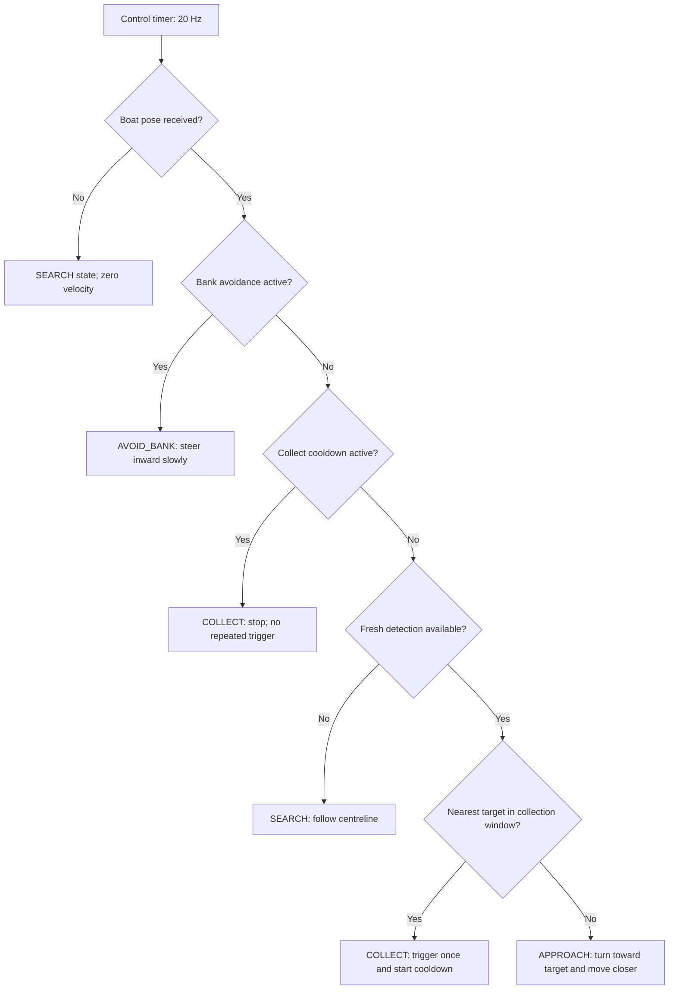

# Explain trash_boat

## A two-minute presentation

“Our project is a vision-guided autonomous trash-collection boat implemented in ROS 2.
The environment is a small Python simulator: a canal, a boat, drifting orange trash,
and a top-down camera.

“The simulator publishes camera images. Our perception node identifies orange blobs
using HSV thresholding and converts their pixel positions into distances relative to
the boat. These detections are sent using the standard `PoseArray` message.

“The controller combines those detections with the boat's pose. It patrols when nothing
is visible, approaches the nearest visible item, triggers a scoop when aligned, and
prioritises bank avoidance whenever necessary. A short cooldown prevents repeated
scoop commands. A standard `Twist` controls forward speed and turning.

“A separate metrics node records collection counts, distance, time, and bank hits.
Those counters are never inputs to the detector or controller. Our nine seed/current
experiments each collected all 12 items without a bank hit. The original three-seed
acceptance checker also passed.

“The main ROS contribution is the complete closed loop: publishers and subscribers,
standard messages, coordinate frames, timer-driven control, typed parameters, launch
configuration, automated tests, and reproducible end-to-end verification.”

## Follow one piece of trash

Suppose its image centroid is `(u=160, v=120)`. The boat sits at `(200, 200)` and there
are 40 pixels per metre:

```text
forward = (200 - 120) / 40 = 2.0 metres
left    = (200 - 160) / 40 = 1.0 metre
```

The detector publishes `(2.0, 1.0)` in the `boat` frame. The controller turns left
because the target is to the left. It reduces speed as it approaches. Once the item
is inside the conservative collection window, it sends one `Empty` message on
`/collect` and holds still for 0.5 seconds. The simulator checks its physical scoop
region and removes items actually inside it.

A collection command is an **attempt**, not a promise that something was collected.
The controller checks the next camera image; it does not inspect the simulator's
answer to decide what to do next.

## The decision made every 50 milliseconds



Bank avoidance uses hysteresis: it enters beyond 3.2 m from the centreline and
continues until the boat returns inside 2.9 m. This avoids rapidly switching states
at the same boundary. Pose and detection messages are asynchronous; the timer makes
a decision using the latest received data. Stale detections are ignored after 0.5 s.

## ROS concepts you can demonstrate

| Concept | Concrete demonstration |
|---|---|
| Nodes | `ros2 node list`: simulator, detector, brain, logger |
| Topics | Follow images → detections → velocity/scoop commands |
| Standard messages | `Image`, `PoseArray`, `PoseStamped`, `Twist`, `Empty`, scalar status messages |
| Coordinate frames | `map` describes the canal; `boat` describes relative target direction |
| Timers | Physics/control 20 Hz, camera 10 Hz, telemetry 2 Hz |
| Parameters | Shared camera scale/geometry in YAML; typed launch overrides |
| Launch | One command starts all four nodes |
| Separation of concerns | Pure vision and controller modules can be tested without ROS imports |
| Verification | Unit/lint tests plus a black-box probe observing the real mission |
| Lifecycle | Ctrl-C stops every node and writes a final metrics summary |

## A short live demo

1. Follow the README build/run commands and start the seed-42 mission.
2. Show `/trash_detector/debug_image` if the image viewer is available.
3. In another correctly sourced terminal, show `/brain_state` and `/trash_collected`.
4. Explain one transition from `SEARCH` to `APPROACH` to `COLLECT`.
5. Show `ros2 node info /collector_brain`: no ground-truth counters are subscribed.
6. Stop with Ctrl-C; show the generated summary and the nine-run results table.

The boat may never enter `AVOID_BANK` during a successful demo. The bank condition is
still tested explicitly; steering toward trash need not produce a bank encounter.
Do not claim a state transition was demonstrated unless it actually appeared.

## Questions to be ready for

**Why HSV?** The simulated trash has a known orange colour, so a transparent classical
method is sufficient. This is not trained AI, and performance on arbitrary real trash
has not been established.

**Why no Gazebo?** The specification calls for a small pure-Python simulator. It makes
seeded runs and automated tests easy, while keeping the project focused on ROS and
the closed perception/control loop.

**Is the system camera-only?** Trash locations are camera-derived. Navigation uses the
simulated boat pose, as the interface explicitly permits. We do not claim visual
localisation or a real-world position estimator.

**How do you know collection worked?** Only the independent metrics/acceptance tools
read the simulator's counters. Their job is evaluation; they never guide the boat.

**Why does the boat continue after finishing?** The brain cannot read the remaining
trash count. It keeps patrolling when no targets are visible. The operator or external
probe stops a measured mission.

**What did you improve?** Completed full launch/config integration, declared missing
dependencies, fixed actual background-SIGINT and idle-node shutdown failures, made
executor initialization explicit, made metrics final snapshots consistent, and ran
the required reproducible experiments.
The baseline detector/controller algorithms already met acceptance, so they were kept.

**What is not proven?** Hardware collection, realistic water dynamics, camera noise and
lighting robustness, arbitrary-seed reliability, and position-estimator performance.
See the measured scope in [RESULTS.md](RESULTS.md).
