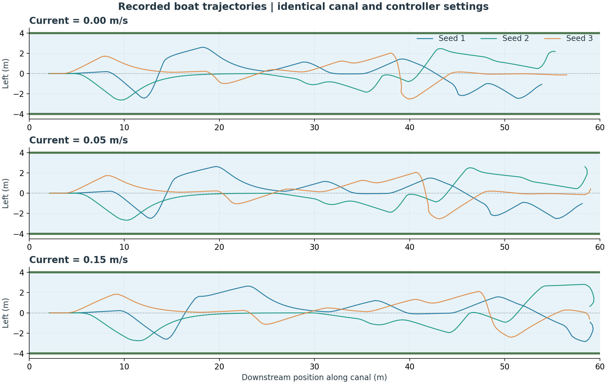

# Mission results

All nine real ROS missions collected **12/12 items with zero bank hits**. The official three-seed gate also passed with the unchanged acceptance tools.

## Measured results

| Seed | Current (m/s) | Collected | Duration (s) | Items/min | Path (m) | Bank hits | 11 items at (s) | 12 items at (s) | Probe |
|---|---|---|---|---|---|---|---|---|---|
| 1 | 0.00 | 12/12 | 82.88 | 8.69 | 58.62 | 0 | 78.0 | 81.5 | PASS |
| 2 | 0.00 | 12/12 | 81.85 | 8.80 | 58.28 | 0 | 77.5 | 80.5 | PASS |
| 3 | 0.00 | 12/12 | 84.11 | 8.56 | 60.17 | 0 | 72.5 | 82.5 | PASS |
| 1 | 0.05 | 12/12 | 87.81 | 8.20 | 62.83 | 0 | 82.5 | 86.5 | PASS |
| 2 | 0.05 | 12/12 | 87.00 | 8.28 | 62.42 | 0 | 82.5 | 85.5 | PASS |
| 3 | 0.05 | 12/12 | 87.13 | 8.26 | 62.81 | 0 | 76.5 | 85.5 | PASS |
| 1 | 0.15 | 12/12 | 88.50 | 8.14 | 64.24 | 0 | 87.0 | 87.0 | PASS |
| 2 | 0.15 | 12/12 | 87.83 | 8.20 | 63.15 | 0 | 84.0 | 86.5 | PASS |
| 3 | 0.15 | 12/12 | 85.00 | 8.47 | 62.20 | 0 | 83.5 | 83.5 | PASS |




## Method

- Seeds: 1, 2, and 3. Currents: 0.0, 0.05, and 0.15 m/s.
- Each run launches all four real nodes and uses the provided `tools/acceptance_check.py` with total 12, timeout 420 s, ratio 0.9, and at most 3 bank hits.
- Canal dimensions, trash count, camera, scoop, controller, and detector settings are identical across configurations. Only seed and the specified experimental current vary.
- A separate output directory stores each CSV, summary, launch log, and probe output. Every run has four clean node exits and matching final CSV/summary counts and path lengths.
- Duration and items/min come directly from `summary.json`. Duration includes startup and the probe settling interval. First reaching 11/12 items is derived from the 2 Hz CSV, so those times have about 0.5 s sampling resolution.
- The default mission keeps patrolling after collection; the external probe ends these measured runs. The controller never reads the collection counters.

## Interpretation

The baseline colour detector and four-state controller meet the contract without changing their algorithms. These nine configurations demonstrate the required current experiment, not a guarantee for arbitrary seeds or real waterways. Compare the measured times and paths above; every configuration collected all items safely.

## Reproduce

```bash
# From the repository root, after building and sourcing install/setup.bash:
export PYTHONNOUSERSITE=1
export ROS_DOMAIN_ID=73 ROS_AUTOMATIC_DISCOVERY_RANGE=LOCALHOST
python3 docs/run_experiments.py --output-dir log/my_experiments
```

Choose a new, empty output directory for each matrix. The runner refuses to overwrite existing results. It saves source SHA-256 hashes in `experiments.json` for attribution.

Committed numeric evidence: [experiments.json](results/experiments.json). The original run CSVs and logs remain under ignored `log/experiments_20261028/`; rerunning the command regenerates them. The figures were plotted from those CSVs and summaries.

Historical files supplied in Downloads are excluded because their durations and path lengths do not identify a matching run (see DECISION-003).

## Limits

- One run per seed/current pair; scheduling can change measured wall times slightly.
- Ideal top-down camera, known scale, synthetic orange trash, perfect simulated pose, and unicycle motion. No wind, waves, real actuator dynamics, or hardware validation.
- The global position is allowed for navigation; trash locations still come only from camera pixels. Ground-truth counters are used only for measurement.
