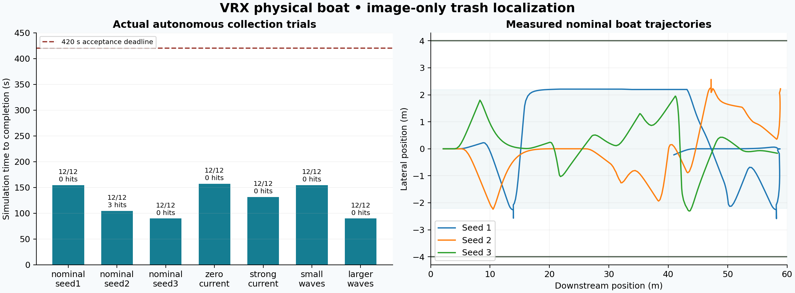

# Measured VRX results

These are real Gazebo Harmonic / VRX missions, separate from the reference
simulator results in RESULTS.md. Images were rendered by Gazebo; the actual
ROS perception, marine decision logic and force controller ran in every trial.

Runtime commit: `bbbae5f98e9e2f8db602a4683fd5a269ae9b722f`.
Runtime source SHA-256: `a42d31cbf6671a240f6a5f896ee7f8ab1f4bd6c9d1a40eb68d607a599cf95708`.
Upstream VRX commit: `03eae362bb544f630595acd53b931e4a7060dffd` (v3.1.0).

| Case | Seed | Current (m/s) | Wave amplitude (m) | Items | Sim time (s) | Wall time (s) | Items/min | Path (m) | Hits | Result |
|---|---:|---:|---:|---:|---:|---:|---:|---:|---:|---|
| nominal_seed1 | 1 | 0.05 | 0.0 | 12/12 | 154.60 | 157.4 | 4.66 | 83.79 | 0 | PASS |
| nominal_seed2 | 2 | 0.05 | 0.0 | 12/12 | 104.58 | 107.45 | 6.88 | 63.44 | 3 | PASS |
| nominal_seed3 | 3 | 0.05 | 0.0 | 12/12 | 89.76 | 92.64 | 8.02 | 61.97 | 0 | PASS |
| zero_current | 1 | 0.0 | 0.0 | 12/12 | 157.16 | 160.08 | 4.58 | 89.18 | 0 | PASS |
| strong_current | 1 | 0.15 | 0.0 | 12/12 | 131.79 | 134.69 | 5.46 | 69.95 | 0 | PASS |
| small_waves | 1 | 0.05 | 0.05 | 12/12 | 154.76 | 157.56 | 4.65 | 83.84 | 0 | PASS |
| larger_waves | 3 | 0.05 | 0.1 | 12/12 | 89.76 | 92.57 | 8.02 | 61.97 | 0 | PASS |



All missions used 12 items, a 60 × 8 m canal, unchanged physical intake
bounds (0–1.5 m forward, ±1 m lateral), and the same declared speed limits.
Passing requires ≥11/12 within 420 simulated seconds and ≤3 actual bank
contact transitions, rendered data, consistent telemetry and clean shutdown.

The nominal seed-2 run had three contact transitions near the end bank.
It satisfies the contract but demonstrates that collision avoidance is not
perfect. The scorer was not filtered or relaxed. Earlier failed development
attempts are retained in verification/vrx/M4_attempt_*.json.

Wave amplitude is the configured VRX analytic component amplitude, not
significant wave height. The water visual is flat; VRX buoyancy forces
and object/boat motion use the configured wave field. Current drives trash
through physical forces; the boat drag model assumes otherwise still water.

## Reproduce

From the workspace after setup/build:

```bash
export PYTHONNOUSERSITE=1
source /opt/ros/jazzy/setup.bash
source install/setup.bash
python3 docs/run_vrx_experiments.py --output log/vrx_repeat --workers 2
```

The output directory must be new. Each case uses an isolated ROS
domain and Gazebo partition; failures remain visible and return nonzero.
Raw archived acceptance JSON, CSV and summaries are in results/vrx/.
