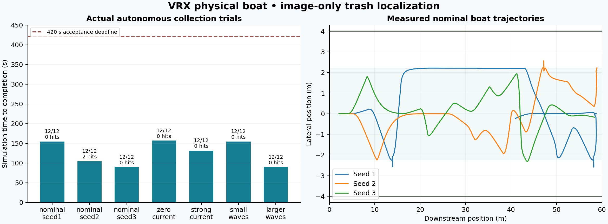

# Final VRX verification after recovery fixes

These seven real software-rendered Gazebo missions used the committed recovery and
shutdown fixes. The earlier [M5 table](RESULTS_VRX.md) remains historical evidence.

Runtime commit: `e17c01cf9ef5ac137baaa6b05201e6fd42ddfc59`.
Source SHA-256: `f9c81ee4b3357f98aea308718c4b3a66e234c09fe0b35e199dabf8a781fae0f1`.
Only GUI layout changed after those trials; [all seven non-GUI worlds remain
byte-identical](verification/vrx/M6_gui_only_diff.json). The final GUI also passed
two complete [launch/collect/stop/restart checks](verification/vrx/M6_restart_probe.json).

Official VRX SHA: `03eae362bb544f630595acd53b931e4a7060dffd`.

| Case | Items | Hits | Sim seconds | Wall seconds | Result |
|---|---:|---:|---:|---:|---|
| nominal_seed1 | 12/12 | 0 | 154.605 | 157.86 | PASS |
| nominal_seed2 | 12/12 | 2 | 104.580 | 107.76 | PASS |
| nominal_seed3 | 12/12 | 0 | 89.760 | 92.82 | PASS |
| zero_current | 12/12 | 0 | 156.895 | 160.02 | PASS |
| strong_current | 12/12 | 0 | 131.580 | 134.54 | PASS |
| small_waves | 12/12 | 0 | 154.760 | 157.79 | PASS |
| larger_waves | 12/12 | 0 | 89.760 | 92.75 | PASS |



Every trial used the actual rendered camera, perception/brain/thruster nodes,
12 objects, the original intake and unchanged acceptance bounds: ≥11/12 within
420 simulated seconds, ≤3 actual bank-contact transitions, matching metrics and
clean shutdown with no runtime errors. No failures were filtered out of this matrix.

The original protected verifier also exited 0 with 82 tests, zero errors/failures/
skips and reference seeds 1/2/3 passing. [Full stdout](verification/vrx/M6_final_reference_verify.txt).

Earlier hosted seed-3 algorithm failure and the subsequent shutdown failure are
retained in [CI failure](verification/vrx/M6_ci_failure.json) and
[shutdown failure](verification/vrx/M6_shutdown_failure.json). The intermediate
matrix was explicitly interrupted after its failed case; it is not this final matrix.

Reproduce after setup/build:

```bash
export PYTHONNOUSERSITE=1 LIBGL_ALWAYS_SOFTWARE=1
source /opt/ros/jazzy/setup.bash
source install/setup.bash
python3 docs/run_vrx_experiments.py --output log/vrx_new_matrix --workers 2
```

[Raw acceptance/CSV/summary files](results/vrx_final/) identify the exact source.
Seed 2 still makes end-bank contact; universal collision-free operation is not
claimed. Ideal localization, known water plane, coloured objects, elevated virtual
camera, geometric intake, flat visual water and simplified current remain model
limitations. Hardware and severe water conditions remain unverified.
