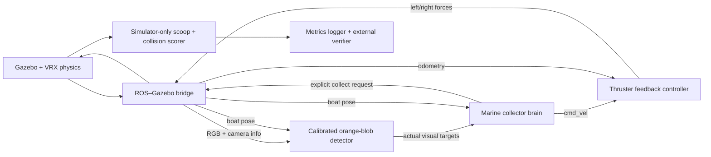

# Run and explain the VRX trash collector

This is a surface-boat simulation for a ROS 2 course. It uses real Gazebo rigid-body
physics and camera rendering, plus official VRX marine physics. No drone is involved.
The original Python simulator is retained for fast regression checks.

## One command on this prepared machine

From the repository root:

```bash
./scripts/run_vrx.sh
```

Gazebo opens with a 3D follow camera and the boat's downward camera feed. The boat
patrols, finds orange floating objects from pixels, approaches, requests a scoop,
and carries on searching. The visible intake is ahead of the blue catamaran.

Close the Gazebo window or press **Ctrl-C** to stop the complete mission. The printed
output directory contains live `metrics.csv` and the final `summary.json`.
To restart, press Ctrl-C, wait for shutdown, then run the same launch command again.

The decision node deliberately cannot see the item counters, so it keeps patrolling
when collection is complete. The independent verifier is what stops a scored run.

Useful variations:

```bash
./scripts/run_vrx.sh seed:=1
./scripts/run_vrx.sh headless:=true seed:=3
./scripts/run_vrx.sh current:=0.15 wave_amplitude:=0.05
```

Only the first command needs a desktop. Headless rendering still needs a working
OpenGL/EGL renderer; a software Mesa renderer can be used with
`LIBGL_ALWAYS_SOFTWARE=1`. There is no silent fallback to the reference simulator.

## Fresh checkout

Use Ubuntu 24.04, ROS 2 Jazzy, Python 3.12 and Gazebo Harmonic. The VRX delivery is
on `codex/vrx-simulation` in [PR #1](https://github.com/Abhinav-Siddharth/ROS-TRASH/pull/1).
For a separate fresh checkout:

```bash
git clone --branch codex/vrx-simulation https://github.com/Abhinav-Siddharth/ROS-TRASH.git
cd ROS-TRASH
```

On the prepared machine, use the existing checkout instead of cloning again.

The dependency download is the official, explicitly approved VRX release, pinned
by exact source SHA in `dependencies.repos`. The generated world needs no Fuel assets.

```bash
export PYTHONNOUSERSITE=1
source /opt/ros/jazzy/setup.bash
./scripts/bootstrap_vrx.sh

# On a machine with rosdep initialized, install the declared system dependencies.
rosdep install --from-paths src external/vrx --ignore-src -y --rosdistro jazzy

export CMAKE_BUILD_PARALLEL_LEVEL=2
colcon build --symlink-install --parallel-workers 2
./scripts/run_vrx.sh
```

The launcher checks for Jazzy, the pinned VRX version and a built integration package,
selects distribution Python libraries, isolates local ROS/Gazebo traffic and preserves
measurements. It does not run sudo, pip, change drivers or install system packages.

## What the ROS graph does



Trash world positions stay inside Gazebo/scoring. They are never sent to the
perception or decision nodes. Boat localization is an ideal simulated sensor.

The marine brain reuses the reference priority order: **avoid bank → collect
cooldown → approach → search**. Physical approach has internal staging, alignment,
creeping and recovery phases, all reported under `APPROACH` for the existing interface.

1. Convert orange blob centroids into camera rays using the real camera intrinsics.
2. Intersect rays with the water plane, accounting for boat height, roll and pitch.
3. Select a nearby visual target and drive toward it. For shoreline targets, first
   stage at a safe boat-centre waypoint.
4. Turn toward the actual target, creep forward while aligned, and request collection.
5. The scorer removes an item only when that request arrives and it is inside the
   original intake: 0–1.5 m forward and ±1.0 m lateral. A waypoint never scores.
6. Hold the existing cooldown, then recover toward the safe corridor. Use reverse
   when facing the bank, or forward when facing inward, steering as needed. Visual
   loss aborts docking. Resume the patrol; large search turns happen in place.

A velocity command is a desired speed, not a teleport. The thruster controller
compares it with odometry, computes surge force and yaw torque, and mixes those into
two thrust values. Gazebo applies the forces; VRX supplies buoyancy and hydrodynamic
drag. Stale commands or odometry cut thrust, after which the boat coasts under drag.

## Five-minute course demonstration

Launch seed 1, then use another terminal:

```bash
export PYTHONNOUSERSITE=1 ROS_DOMAIN_ID=83 ROS_AUTOMATIC_DISCOVERY_RANGE=LOCALHOST
source /opt/ros/jazzy/setup.bash
source install/setup.bash
ros2 topic echo /brain_state --field data
```

Show the blue boat, camera feed, a shoreline approach, scoop event, and retreat.
In separate terminals, show `/trash_collected`, `/cmd_vel`, or `/boat/thrusters/left`.
For annotated detections, if the optional viewer is installed:

```bash
ros2 run rqt_image_view rqt_image_view /trash_detector/debug_image
```

Explain: “The camera tells the brain where trash appears relative to the boat.
The brain chooses a safe manoeuvre. Feedback converts its speed request into forces.
Only the external evaluator knows how much trash remains.”

Finish with the measured results graph and raw telemetry, then close Gazebo. Show
that shutdown produced the summary and left no mission nodes running.

## Verify it independently

The original protected verifier still checks the reference simulator:

```bash
export PYTHONNOUSERSITE=1
source /opt/ros/jazzy/setup.bash
./tools/verify.sh
```

The physical verifier builds, runs every unit/lint test, then three actual VRX missions:

```bash
./scripts/verify_vrx.sh
```

One physical mission with a new output directory:

```bash
export PYTHONNOUSERSITE=1 ROS_DOMAIN_ID=83 ROS_AUTOMATIC_DISCOVERY_RANGE=LOCALHOST
source /opt/ros/jazzy/setup.bash
source install/setup.bash
ros2 run trash_boat_vrx verify_mission --seed 1 --output log/vrx_check_1
```

Acceptance requires real rendered frames, visual detections, control/pose traffic,
at least 11/12 items in 420 simulated seconds, at most three bank contact transitions,
consistent CSV/summary data and clean process shutdown. It rejects runtime errors.
Wall time is recorded separately and bounded to catch a stopped/slow simulator.

[Seven final measured trials](RESULTS_VRX_FINAL.md) include currents 0, 0.05 and 0.15 m/s and
wave amplitudes 0, 0.05 and 0.10 m. The result files identify their exact source hash.
Earlier development failures remain documented, rather than being overwritten.

## Limits to explain honestly

- Orange objects, a known water plane, ideal boat localization and an elevated
  virtual camera are intentional simplifications. The camera mount is 6 m above
  the boat; it is a simulation sensor, not a validated physical camera installation.
- Water is rendered as a flat plane. Analytic VRX waves still affect buoyancy,
  heave and attitude; that physical motion was independently measured.
- The current parameter drives floating trash with forces. Boat drag uses otherwise
  still water; this is not a validated ocean-current or wind model.
- Collection is an explicit geometric intake event with removal, not a simulated
  conveyor, net entanglement or payload capacity model.
- Nominal seed 2 had two end-bank contact transitions in the final matrix
  (three in earlier trials). It passes the stated
  contract; collision-free operation for every seed or disturbance is not claimed.
- These are simulation results. Hardware, uncoloured real litter, GPS/IMU noise,
  severe waves and deployment on water have not been validated.

## Troubleshooting

- **cv_bridge / NumPy crash:** use `PYTHONNOUSERSITE=1` and system ROS/Python libraries.
- **No rendered frames:** check OpenGL/EGL, display permissions and `mission.log`.
  Headless mode is rendering without a window, not rendering without graphics support.
- **Missing VRX library:** rerun the pinned bootstrap, build and source `install/setup.bash`.
- **Unrelated topic traffic:** use another `ROS_DOMAIN_ID` and `GZ_PARTITION` for each
  concurrent mission. The experiment runner does this automatically.
- **No initial trash visible:** spawning begins at x=8 m and the boat starts at x=2 m;
  the first few seconds of search with an empty camera are expected.
- **Output directory already exists:** choose a new directory. The verifier refuses
  to overwrite an earlier run.

Upstream references: [VRX](https://github.com/osrf/vrx/tree/v3.1.0),
[Gazebo Harmonic](https://gazebosim.org/docs/harmonic/),
[ROS 2 Jazzy](https://docs.ros.org/en/jazzy/).
